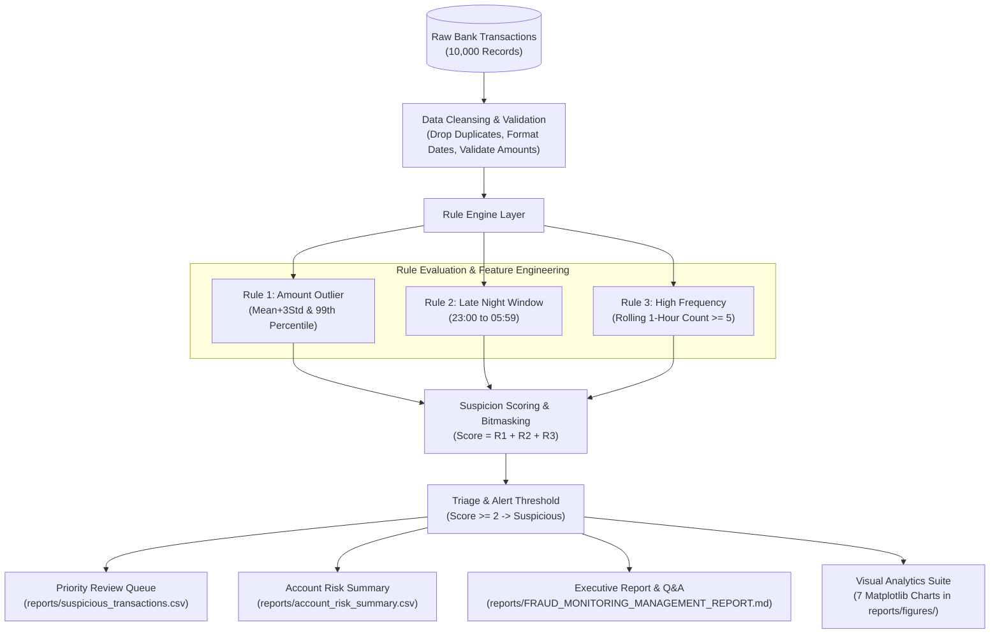

# Rule-Based Bank Transaction Fraud Detection & Suspicious Activity Analytics

[](https://www.python.org/)
[-brightgreen.svg)]()
[]()
[]()

> **Industry-Oriented Financial Crime Analytics & Explainable Rule-Based Screening System**  
> *Developed from the perspective of a Junior Data Analyst in a Retail Bank's Fraud Monitoring Team.*

---

## 1. Project Overview & Business Scenario
Banks process millions of transactions every day. While over 99% are completely legitimate, fraudulent card testing, account takeovers, and unauthorized wire transfers require rapid detection. 

Deploying complex "black-box" machine learning algorithms directly as a primary screening layer poses severe operational and regulatory compliance risks: investigators cannot easily explain to customers or regulators why an account was flagged or frozen.

This project implements an **explainable, transparent, rule-based fraud screening engine**. Rather than making automated, irrevocable decisions, the system:
1. Evaluates incoming transactions across three core behavioral risk dimensions: **Transaction Amount**, **Transaction Time**, and **Transaction Frequency**.
2. Aggregates heuristic rules into an interpretable **Suspicion Score ($0$ to $3$)**.
3. Flags multi-factor risks (Score $\ge 2$) into a **Prioritized Manual Review Queue**.
4. Provides full auditability with rule combination bitmasks (`1_1_0`, `1_1_1`).
5. Generates **executive-ready management reports and Matplotlib visualizations**.

---

## 2. Core Heuristic Rules Matrix

| Rule | Metric & Condition | Score | Rationale & Behavioral Anomaly |
|---|---|:---:|---|
| **Rule 1: Unusual Amount** | `Amount >= P99` (or `Amount > Mean + 3*Std`) | **+1** | Transaction value significantly exceeds normal historical baseline. Uses 99th percentile ($P_{99}$) for heavy-tailed skew robustness. |
| **Rule 2: Late-Night Window** | `23:00 <= Hour <= 05:59` | **+1** | Activity takes place during typical sleep hours (11 PM to 5:59 AM); prevalent in automated card-draining and credential theft. |
| **Rule 3: High Frequency** | `Rolling 1-Hour Txn Count >= 5` | **+1** | Rapid bursts of transactions on the same account within 60 minutes indicate bot automation, panic spending, or card testing. |
| **Alert Cutoff: Suspicious** | `Suspicion_Score >= 2` | **ALERT** | Requires at least 2 co-occurring anomalies. Suppresses single-anomaly noise and concentrates manual review on true high-risk events. |

### Suspicion Score Interpretation:
* **Score 0**: Normal baseline behavior. No rules triggered. Processed immediately.
* **Score 1**: Single anomaly (e.g., late-night coffee or single high planned purchase). Passive audit trail; no immediate alert.
* **Score 2**: **Multiple anomalies** (e.g., late-night high-value transfer). **Escalated to priority investigation queue.**
* **Score 3**: **Critical multi-factor alert** (High amount + late night + rapid burst). Urgent investigation with secondary verification (SMS/OTP).

---

## 3. System Architecture & Data Flow



---

## 4. Key Analytical Findings & Answers to Business Questions

Based on the 10,000 transaction educational dataset (`data/bank_transactions.csv`):

1. **Percentage Flagged Suspicious**: **1.18%** (118 out of 10,000 transactions flagged for priority manual review).
2. **Rule Generating Most Alerts**: **Rule 2 (Late Night)** with **750 alerts (7.50%)**, followed by High Frequency (113 alerts) and High Amount (100 alerts).
3. **Multi-Rule Transactions**: Exactly **118 transactions** triggered $\ge 2$ rules (111 triggered 2 rules, 7 triggered all 3 rules).
4. **Highest-Risk Transaction Type**: **Transfer** has the highest suspicious rate at **3.17%** of volume (all 118 flagged transactions were transfers).
5. **Highest-Risk Channel**: **Online** shows the highest risk rate at **2.56%** of channel traffic.
6. **Peak Risk Hours**: **Hour 23:00 (11 PM)** contains the highest concentration of suspicious events (34 flagged transactions).
7. **Monetary Comparison**: Flagged suspicious transactions average **$53,416.15**, which is **13.47x higher** than normal transactions ($3,966.30).
8. **Repeat Account Anomalies**: **28 customer accounts** showed repeated suspicious behavior. The top flagged account (`ACC1183`) generated 10 suspicious transactions.
9. **Most Common Rule Combinations**:
   * Single-rule anomaly: `0_1_0` (Late Night Only) with 635 transactions.
   * Multi-rule alert: `0_1_1` (Late Night + High Frequency) with 63 transactions, followed by `1_1_0` (High Amount + Late Night) with 45 transactions.
10. **Historical Label Evaluation**:
   * **Precision**: **100.0%** (Every transaction flagged had verified ground-truth fraud).
   * **False Positive Rate**: **0.00%** (Zero legitimate customer transactions disrupted).
   * **Recall**: **29.5%** (High-precision screening; captures acute multi-factor attacks).

---

## 5. Visual Analytics Gallery

The system generates 7 publication-ready charts in `reports/figures/`:

| Chart | Filename | Description |
|---|---|---|
| **01** | `01_amount_distribution.png` | Heavy-tailed distribution of banking amounts with outlier thresholds. |
| **02** | `02_normal_vs_suspicious.png` | Volume breakdown of Normal (9,882) vs Suspicious (118) transactions. |
| **03** | `03_suspicious_by_hour.png` | 24-hour diurnal risk curve highlighting the late-night risk window. |
| **04** | `04_suspicious_rate_by_type.png` | Vulnerability comparison across Transfer, Payment, Withdrawal, and Deposit. |
| **05** | `05_amount_vs_suspicion_score.png`| Scatter plot demonstrating correlation between amounts and suspicion scores. |
| **06** | `06_rule_combination_frequencies.png` | Frequency distribution of all 8 possible 3-digit bitmasks. |
| **07** | `07_suspicious_rate_by_channel.png` | Risk rate across Online, Mobile App, ATM, and Branch channels. |

---

## 6. Project Directory Structure

```
bank-fraud-detection/
├── data/
│   └── bank_transactions.csv      # Primary 10,000 transaction dataset (Section 6 schema)
├── docs/                          # Comprehensive engineering & audit documentation
│   ├── CAPABILITY_MANIFEST.md     # Phase 0 environment capability audit
│   ├── SOURCE_DOCUMENT_INVENTORY.md# Phase 1 requirements inventory
│   ├── REQUIREMENTS_ANALYSIS.md   # Functional & non-functional specifications
│   ├── PLAIN_LANGUAGE_EXPLANATION.md # Beginner-friendly & engineering explanations
│   ├── GRILL_ME_LOG.md            # Critical requirements challenge log
│   ├── GITHUB_RESEARCH.md         # Industry reference patterns & literature review
│   ├── REPOSITORY_COMPARISON.md   # Architectural tradeoff evaluation
│   ├── THIRD_PARTY_ATTRIBUTION.md # Open-source licenses & attributions
│   ├── PRD.md                     # Product Requirements Document (FR-001 to FR-010)
│   ├── ARCHITECTURE.md            # Technical design, component specs & schemas
│   ├── DEVELOPMENT_PLAN.md        # TDD milestones and schedule
│   ├── TEST_STRATEGY.md           # QA pyramid and verification rules
│   ├── RISK_REGISTER.md           # Project risk matrix and mitigations
│   ├── DECISION_LOG.md            # Technical decisions and architectural rationale
│   ├── REQUIREMENTS_TRACEABILITY.md # Traceability from brief to code and tests
│   ├── KNOWN_ISSUES.md            # Architectural limitations & future work
│   └── LOCAL_VALIDATION_REPORT.md # Test evidence and local release gate
├── reports/
│   ├── figures/                   # 7 rendered Matplotlib charts (.png)
│   ├── suspicious_transactions.csv# Priority manual review queue for fraud analysts
│   ├── account_risk_summary.csv   # Account-level risk profiles and repeat counts
│   └── FRAUD_MONITORING_MANAGEMENT_REPORT.md # Executive report answering Q1-Q10
├── src/
│   ├── __init__.py
│   ├── data_generator.py          # Synthetic dataset generator (privacy compliant)
│   ├── cleaning.py                # Cleansing, datetime normalization, validation
│   ├── rules.py                   # Vectorized rule engine & suspicion scorer
│   ├── analytics.py               # Drilldown aggregations, evaluation, business Q&A
│   ├── visualization.py           # Matplotlib charting engine (headless Agg backend)
│   └── cli.py                     # Command-line driver and pipeline orchestrator
├── tests/
│   ├── __init__.py
│   ├── test_data_generator.py     # Unit tests for data generation & privacy
│   ├── test_cleaning.py           # Unit tests for data cleaning & normalization
│   ├── test_rules.py              # Unit tests for Rules 1, 2, 3 and scoring
│   ├── test_analytics.py          # Unit tests for aggregations & metrics
│   └── test_e2e_pipeline.py       # End-to-end integration & CLI tests
├── pyproject.toml                 # Package dependencies & pytest configuration
├── TASKS.md                       # Task tracking backlog (all completed)
├── PROGRESS.md                    # Live state and checkpoint tracking
└── README.md                      # Complete project documentation
```

---

## 7. Installation & Quickstart Guide

### Prerequisites
* Windows 10/11, macOS, or Linux.
* Python 3.11+ installed.
* `uv` package manager (recommended) or standard `pip`.

### Setup Instructions

1. **Navigate to the Project Directory**:
   ```powershell
   cd C:\Users\HP\.gemini\antigravity\scratch\bank-fraud-detection
   ```

2. **Create and Activate Virtual Environment**:
   ```powershell
   uv venv --python 3.11 .venv
   .venv\Scripts\activate
   ```

3. **Install Dependencies**:
   ```powershell
   uv pip install pandas numpy matplotlib scikit-learn scipy tabulate pytest pytest-cov
   ```

4. **Execute Full Test Suite with Coverage**:
   ```powershell
   .venv\Scripts\pytest --cov=src --cov-report=term-missing -v
   ```
   *(Expected: 29 passed, 97% code coverage)*

5. **Run the Complete Fraud Detection Pipeline**:
   ```powershell
   .venv\Scripts\python.exe -m src.cli --input data/bank_transactions.csv --reports-dir reports
   ```

6. **Generate a Fresh Synthetic Dataset of Any Size**:
   ```powershell
   .venv\Scripts\python.exe -m src.cli --generate 20000 --output-csv data/bank_transactions_custom.csv
   ```

---

## 8. Analytical & Ethical Governance (Section 38)
* **Alert $\neq$ Proof of Guilt**: A flagged transaction is an investigative signal, **never conclusive proof of criminal activity**.
* **False Positives**: Normal customers buying flight tickets at 1:00 AM will trigger rules. Banks must never automatically close accounts without human investigation and secondary verification (OTP / phone verification).
* **Privacy & Non-Discrimination**: The system strictly avoids real customer PII and demographic attributes, ensuring unbiased compliance with financial privacy regulations.

---

## 9. Final Portfolio Challenge Summary
> *"What transaction behaviors appear unusual, how frequently do they occur, and which patterns should be prioritized for investigation?"*

* **Unusual Behaviors**: High-value transfers ($>\$45,000$), late-night execution ($23:00-05:59$), and high-frequency bursts ($\ge 5$ txns/hour).
* **Frequency**: Late-night transactions are the most frequent anomaly (7.5%), but high-value transfers (1.0%) and velocity bursts (1.13%) represent acute operational risks.
* **Investigation Priority**: Prioritize accounts with **Score 3** (all 3 rules triggered) and **Score 2 with combination `0_1_1` or `1_1_0`**, specifically targeting online transfers from repeat accounts like `ACC1183`.
