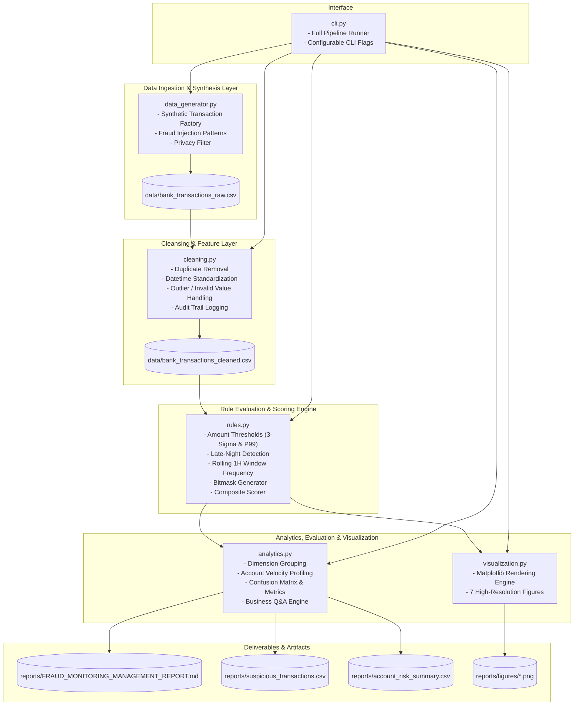

<p align="left">
  
</p>

# System Architecture & Technical Design

## 1. System Architecture Overview

The system follows a modular, pipeline-oriented architecture designed for deterministic execution, high performance, and comprehensive testability.



---

## 2. Component Directory Structure

```
bank-fraud-detection/
├── .venv/                         # Isolated Python 3.11 virtual environment
├── data/
│   ├── bank_transactions_raw.csv  # Generated raw transaction stream
│   └── bank_transactions.csv      # Cleaned and normalized transaction dataset
├── docs/                          # Engineering and requirements documentation
│   ├── CAPABILITY_MANIFEST.md
│   ├── SOURCE_DOCUMENT_INVENTORY.md
│   ├── REQUIREMENTS_ANALYSIS.md
│   ├── PLAIN_LANGUAGE_EXPLANATION.md
│   ├── GRILL_ME_LOG.md
│   ├── GITHUB_RESEARCH.md
│   ├── REPOSITORY_COMPARISON.md
│   ├── THIRD_PARTY_ATTRIBUTION.md
│   ├── PRD.md
│   ├── ARCHITECTURE.md
│   ├── DEVELOPMENT_PLAN.md
│   ├── TEST_STRATEGY.md
│   ├── RISK_REGISTER.md
│   ├── DECISION_LOG.md
│   ├── REQUIREMENTS_TRACEABILITY.md
│   ├── KNOWN_ISSUES.md
│   └── LOCAL_VALIDATION_REPORT.md
├── reports/
│   ├── figures/                   # Rendered Matplotlib visualizations (.png)
│   ├── suspicious_transactions.csv# Priority manual review queue
│   ├── account_risk_summary.csv   # Account-level risk aggregation
│   └── FRAUD_MONITORING_MANAGEMENT_REPORT.md # Comprehensive management report
├── src/
│   ├── __init__.py
│   ├── data_generator.py          # Synthetic dataset builder (10,000+ txns)
│   ├── cleaning.py                # Cleaning and validation logic
│   ├── rules.py                   # Heuristic detection rules & composite scorer
│   ├── analytics.py               # Aggregations, drilldowns, Q&A, and metrics
│   ├── visualization.py           # Matplotlib charting engine
│   └── cli.py                     # Command-line driver application
├── tests/
│   ├── __init__.py
│   ├── test_data_generator.py     # Unit tests for data generation
│   ├── test_cleaning.py           # Unit tests for data cleansing
│   ├── test_rules.py              # Unit tests for fraud detection rules
│   ├── test_analytics.py          # Unit tests for reporting aggregations
│   └── test_e2e_pipeline.py       # End-to-end integration and smoke tests
├── TASKS.md                       # Task tracking backlog
├── PROGRESS.md                    # Live state and resume checkpoint
├── pyproject.toml                 # Package and test configuration
└── README.md                      # Comprehensive execution and setup guide
```

---

## 3. Data Schema and Types

| Column | Raw Type | Cleaned Type | Nullable | Validation Rules |
|---|---|---|---|---|
| `Transaction_ID` | string | string | No | Unique, non-empty, pattern `TX\d+` |
| `Account_ID` | string | string | No | Valid customer account `ACC\d+` |
| `Transaction_Date` | string | `datetime64[ns]` | No | Valid ISO date `YYYY-MM-DD` |
| `Transaction_Time` | string | string / time | No | Valid `HH:MM` or `HH:MM:SS` |
| `Amount` | float/string | `float64` | No | $> 0.00$ |
| `Transaction_Type` | string | category | No | `Transfer`, `Withdrawal`, `Payment`, `Deposit` |
| `Channel` | string | category | No | `Online`, `Mobile App`, `ATM`, `POS / Branch` |
| `Merchant_Category` | string | category | Yes | `Electronics`, `Grocery`, `Jewelry`, etc. |
| `Location` | string | string | No | City or regional center |
| `Device_ID` | string | string | Yes | Unique hardware identifier |
| `Balance_Before` | float | `float64` | No | $\ge 0.00$ |
| `Balance_After` | float | `float64` | No | $\ge 0.00$ |
| `Fraud_Label` | int | `int64` | Yes | Ground truth historical label ($0$ or $1$) |

---

## 4. Error Handling and Defensive Strategies
1. **Datetime Parsing Resilience**: Uses `pd.to_datetime(..., errors='coerce')` with explicit fallback formats (`%H:%M`, `%H:%M:%S`).
2. **Missing / Corrupt Values**: Explicit drop or imputation with full logging in `cleaning_log`.
3. **Empty Data Handling**: All analytical functions check for `df.empty` and raise meaningful `ValueError` messages rather than crashing with unhandled exceptions.
4. **Division by Zero Protection**: Suspicious rate calculations check if total transaction count is zero before computing percentages.
