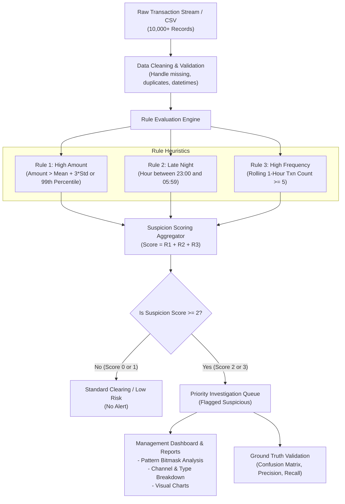

# Plain Language Project Explanation
## Explainable Rule-Based Fraud Detection System for Retail Banking

---

## 1. Executive Analogy & Beginner Explanation

### What Problem Are We Solving?
Imagine an airport security checkpoint. Millions of travelers pass through terminal gates every day. The security team cannot search every single passenger with an intensive, full-body physical inspection—that would cause massive delays, infuriate honest passengers, and bring airport operations to a complete standstill. 

Instead, the airport sets up automated screening metal detectors and X-ray scanners. If a bag contains an unusually dense metal object, or someone triggers the alarm, the passenger is politely stepped aside for a manual bag check by a trained security officer.

In retail banking, **transactions are the passengers**, and **fraud detection is the airport scanner**.
Every day, a bank processes millions of transactions: morning coffee purchases, monthly utility payments, grocery shopping, ATM withdrawals, and business payroll transfers. 99.8% of these transactions are completely honest. However, criminals occasionally attempt credit card skimming, account takeovers, unauthorized wire transfers, or rapid-fire automated bot card-testing attacks.

If the bank automatically blocks every unusual transaction or calls the police on the customer, honest customers will be locked out of their accounts during dinner or hospital emergencies. That is why **the goal of first-level fraud screening is NOT to label customers as criminals; it is to flag suspicious records and place them in a prioritized queue for a human fraud investigator to examine.**

---

## 2. Who Are the Users?
1. **Junior Fraud Data Analyst / Investigator**: Looks at flagged alerts, reads the explanation (e.g., *"This transfer was \$95,000 at 3:15 AM from an account that just had 6 transfers in the past 20 minutes"*), checks previous customer history, and decides whether to approve, verify via SMS/OTP, or escalate.
2. **Fraud Risk Manager**: Reviews aggregated reports (e.g., *"Why did mobile transfers during late-night hours surge by 40% this week?"*) to tune bank risk policies.
3. **Internal Audit & Compliance Officers (RBI / Banking Regulators)**: Requires transparent, explainable logic to prove that the bank's screening does not discriminate unfairly and complies with financial oversight guidelines.

---

## 3. How the System Actually Works: Step-by-Step

### The Three Core Rules:
1. **Rule 1: Unusually High Transaction Amount**
   * *Concept*: If an average account transaction is \$150, but someone initiates a \$90,000 wire transfer, this deviates wildly from expected norms.
   * *Formula*: Either statistical 3-sigma ($\mu + 3\sigma$) or the 99th percentile ($P_{99}$).
2. **Rule 2: Unusual Late-Night Hours**
   * *Concept*: Most human beings are asleep between 11:00 PM and 6:00 AM. Fraudsters and automated international botnets frequently operate in the early morning hours to delay customer discovery.
   * *Formula*: `(Hour >= 23) | (Hour <= 5)`.
3. **Rule 3: High-Frequency Transaction Burst**
   * *Concept*: An attacker testing stolen card credentials or quickly draining an account balance will perform multiple rapid transactions in rapid succession.
   * *Formula*: Rolling 1-hour window per `Account_ID` with $\ge 5$ transactions.

---

## 4. The Suspicion Score Matrix

| Score | Meaning | Operational Action |
|:---:|---|---|
| **0** | Normal baseline behavior. No unusual triggers. | Process immediately. |
| **1** | Single anomaly (e.g., late-night coffee or single large planned paycheck). | Normal clearing; passive audit trail. |
| **2** | **Multiple anomalies** (e.g., high amount during late-night, or 6 transactions at 3 AM). | **Flag for high-priority investigator review.** |
| **3** | **Critical anomaly**: High amount + late night + rapid burst. | **Urgent immediate review & secondary verification (SMS/OTP).** |

---

## 5. Engineering Architecture & Technical Depth

### Why These Specific Technologies?
* **Python**: Industry lingua franca for data analytics, scientific computing, and financial fraud modeling.
* **Pandas**: High-performance in-memory tabular data manipulation, time-series windowing, and grouped aggregations.
* **NumPy**: Fast vectorized array arithmetic for statistical thresholding ($\mu$, $\sigma$, percentiles).
* **Matplotlib**: Clean, reproducible, publication-ready data visualizations without external rendering dependencies.
* **Pytest**: Automated test-driven development (TDD) assuring zero regressions in scoring and rule calculations.

### The Most Challenging Technical Nuances:
1. **Rolling Time-Window Calculation**: Grouping transactions per account and computing a sliding 1-hour rolling count across calendar days without lookahead bias.
2. **Skewness in Financial Amounts**: Banking amounts are Pareto/log-normally distributed (many small \$10 purchases, few \$50,000 transfers). Simple $\mu + 3\sigma$ assumes a Gaussian bell curve, which can fail if extreme outliers inflate $\sigma$. The 99th percentile ($P_{99}$) provides an interpretable, robust alternative.
3. **Precision vs. Recall Tradeoff**: If we alert on every score $\ge 1$, we catch almost all fraud (high recall), but overwhelm investigators with thousands of false positives (low precision). Raising the bar to $\ge 2$ concentrates investigative effort on high-confidence leads.

---

## 6. Prototype vs. Working Application vs. Production System

| Dimension | Prototype / Classroom Script | Our Working Application | Real Production Banking System |
|---|---|---|---|
| **Data Ingestion** | Hardcoded dummy list | Automated CSV loader with schema validation & data cleaner | Kafka / Apache Flink real-time streaming pipeline |
| **Rule Engine** | Single procedural script | Modular, tested Python package with CLI and full test suite | Distributed CEP (Complex Event Processing) engine |
| **Verification** | Eyeballed print statements | 100% automated Pytest suite + E2E validation | Continuous integration (CI/CD), canary rollouts |
| **Persistence** | None | Cleaned datasets, CSV queues, exported high-res figures | Enterprise Data Lake (Snowflake/BigQuery) + Audit DB |
| **Investigation** | Simple `df.head()` | Prioritized triage queues, bitmask patterns, management report | Case Management System (ServiceNow / Actimize) |
